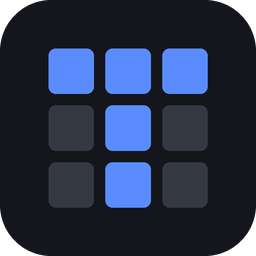

<p align="center"></p>

<h1 align="center">TTPF Studio for GTA 6</h1>

<p align="center">Texture, 3D model, archive and video tool for <b>Grand Theft Auto VI (GTA 6)</b>: view, export and replace textures in <code>.ttpf</code> packs, recover files from <code>RPF9</code> archives, export 3D models to OBJ, play Bink videos, and browse everything in one searchable library.</p>

---

## What it does

**Easy to start:** the welcome page has big buttons for 3D models, your game folder, the Library and single files. **🧊 3D models** in the top bar goes straight to Vehicles, Animals, People, Clothing, Weapons, Props, Plants, Buildings or Terrain; the 3D view opens inside the main window (← Back returns to the files). Opening the game folder shows it as a folder tree with an icon per file type and the size of every folder.

**Texture packs (`.ttpf`)**
- Reads the pack index and texture table, follows each texture's mip chain and decodes the full-resolution image.
- Formats: BC1, BC2, BC3, BC4, BC5, BC6H, BC7, RGBA8, BGRA8, RGBA16F.
- Undoes the GPU swizzle (two tile layouts, picked per texture from the texture table).
- Packs with a missing or damaged header still open: textures are found by scanning, their mip levels are grouped, and format and size are guessed. A wrong guess can be corrected in the app.
- Viewer with zoom, pan, channel isolation (R / G / B / A / Split), a thumbnail grid, and a guess at what each texture is for (colour, normal map, packed data, greyscale).
- Export PNG or DDS. Replace a texture from PNG (RGBA8, BC1, BC2, BC3, BC5) or from DDS (any supported format, including BC7), then save a modded copy of the pack. The original file is never modified.

**RPF9 archives (`.rpf`)**
- The file list inside RPF9 is encrypted and this tool does not decrypt it. Much of the data inside is not encrypted, though, so the tool recovers what it can: XML and text files (rejoined from their 64 KB chunks), Bink / Bink 2 videos (cut out exactly using the size in their header), PSIN resources and other binary blobs.
- Original file names and folders are not available; recovered files are named from their content.
- Videos: **Play** opens them in RAD Video Tools; **Convert to MP4** turns them into normal H.264/AAC MP4 files. Both need [RAD Video Tools](https://www.radgametools.com/bnkdown.htm) installed (free, cannot be bundled), and converting also needs [ffmpeg](https://ffmpeg.org/). Converting needs temporary disk space for the uncompressed video, about 6 MB per 1080p frame.

**3D models**
- Finds every named model in an RPF9 archive (characters, heads, clothing, shoes, cars, boats and their tuning parts, props, map sectors, building interiors) and decodes its mesh: positions, UVs and triangles.
- Colours: each material's texture is found in the `.ttpf` packs by its hash and shown on the model; vehicle paint uses a colour you pick.
- **Complete vehicles first:** under Vehicles, every complete high-detail vehicle (`<name>_hi.#ft`) is listed first, marked ★.
- **Category buttons:** Vehicles, Animals, People, Clothing, Wheels, Weapons, Props, Plants, Interiors, Terrain, Buildings & map, with counts. Vehicles are recognised by their car-paint materials, so every vehicle and all its parts (glass, interior, trim, tuning parts) land under Vehicles, whatever they are called.
- Textured preview: every pixel samples the model's real texture, with smooth lighting and anti-aliasing (drag to turn, wheel to zoom). **Export OBJ** for one model or every listed model, with an `.mtl` file and the textures as PNG, ready for Blender.
- **Whole map:** in an archive with terrain, one click builds the map as one glTF (`.glb`) or OBJ file in world coordinates. glTF stores each model once and every placed copy as a reference to it, so it is about ten times smaller than OBJ for a city area. Terrain tiles and the buildings and props placed on them are put where the game's placement files say, at their real height, and the ground colours are painted from the game's own baked colour maps into one top-down PNG. Export one 512 m cell (`s13_w19`), a block between two corner cells, or everything. Placed models stored in other archives are included once those archives have been indexed in the library and opened in the 3D model window.
- Format notes on the model layout come from the [6Stars](https://github.com/Ahmet-Dedeler/6Stars) project, and on map placement from the [RageForge](https://github.com/nullbrik/RageForge) project; the decoders here are separate implementations.

**Library**
- Indexes a whole game folder once into a catalogue: every 3D model, every texture of every pack, every file recovered from every archive. It is sorted into a tree where each group holds one kind of thing: **3D models** (vehicles by model name, animals by species, people, weapons, props…), **Textures** (vehicles, peds & clothing, props, terrain, UI…), **Videos**, **Game data** (XML by type), skeletons and scripts.
- Opening a 3D model from the Library jumps straight to it in the 3D window.
- Browse by category, search everything at once, preview, open any item in the main window instantly, or export a whole selection. Re-indexing only re-reads packs that changed.

**Bulk export**
- "Export everything" walks a whole folder of packs and writes every texture as a PNG sorted into `<pack>/<Colour | Normal map | Packed data | Greyscale>/`, with an `index.csv` catalogue (format, size, file offset, content hash). It skips blank textures and duplicates, uses all CPU cores, and resumes if stopped. It can also recover RPF archive contents (`files.csv`).

## Platform support

| Source | Status |
|---|---|
| GTA 6 on Xbox Scarlett (X/S) | Assumed tested and working |
| GTA 6 on PC | Not confirmed. Textures stored without swizzle can be viewed with the *Linear* tiling option |
| GTA 6 on PS5 | Not supported if the packs use a different compressor (such as Oodle Kraken) |

## Roadmap

- **Character colours.** Ped and clothing colour maps are chosen at run time by name, and the name hash is not known yet, so characters show without colour.
- **Skeletons and animations.**
- **Vehicle wheels and paint layers.** Wheels are separate models attached in game, so vehicles show without them for now, and every painted part uses the one paint colour you pick.
- **Embedded textures.** Many props and buildings keep their textures inside the model file rather than in the `.ttpf` packs; those export without them for now.
- **Faster first index** for very large archives.

## Install

### The easy way (Windows, nothing else needed)

1. Go to [**Releases**](https://github.com/woreksami/ttpf-studio/releases/latest) and download **`TTPF-Studio-windows.zip`**.
2. Right-click the zip → **Extract All…** and pick where to keep it (for example your Documents folder).
3. Open the extracted **TTPF Studio** folder and double-click **`TTPF Studio.exe`**.
   - If Windows shows *"Windows protected your PC"*, click **More info** → **Run anyway**. The app is not code-signed, so Windows shows this for any new download.
4. Want it on your Desktop and in the Start menu? Double-click **`Add desktop shortcut.bat`** in the same folder.
   To pin it to the taskbar, right-click the Start menu entry → **Pin to taskbar**.

To update, download the new zip and extract it over the old folder. Your settings and library index are kept (they live in `%APPDATA%\TTPF Studio`).

### First steps in the app

1. On the welcome page click **Open your game folder** and choose the folder with `levels.rpf`, `packs.rpf` and the `data` folder in it.
2. Click **🧊 3D models** (top bar) → **Vehicles**, **Animals**, **People**… The first time an archive is opened it is scanned once (a few minutes for the biggest ones); after that it opens in seconds.
3. Click **Library** → **Update index** once to make everything searchable by name.

### From source (any OS with Python 3.10+)

One line in PowerShell (needs [Git](https://git-scm.com/) and [Python](https://www.python.org/downloads/)):

```powershell
git clone https://github.com/woreksami/ttpf-studio; cd ttpf-studio; pip install -r requirements.txt; python ttpf_tool.py --install
```

`--install` copies the app to `%LOCALAPPDATA%\Programs\TTPF Studio` and adds Start menu and Desktop shortcuts. Without it, run `python ttpf_tool.py`.

## Command line

```powershell
python ttpf_tool.py path\to\pack.ttpf                 # open a file in the app
python ttpf_tool.py --dump <packs folder> <output>     # export every texture (add --rpf to also recover RPF contents)
python ttpf_tool.py --rpf path\to\archive.rpf          # print an RPF9 header
python ttpf_tool.py --selftest                         # run the built-in tests
```

## Safety

The app only reads your game files. Everything it writes goes to the folder you choose, to `%APPDATA%\TTPF Studio` (settings, error log) or to its install folder. Saving a modded pack always writes a new file.

## How the formats work

See [FORMATS.md](FORMATS.md) for the reverse-engineered layout of the pack index, texture table, mip chains, GPU swizzle and RPF9 archives.

## Legal

This is an unofficial fan-made tool. It is not affiliated with or endorsed by Rockstar Games or Take-Two Interactive. Grand Theft Auto, GTA and GTA VI are trademarks of Take-Two Interactive. It contains no game files, game assets or encryption keys. Use it only with files you are allowed to use.

## License

MIT, see [LICENSE](LICENSE).
